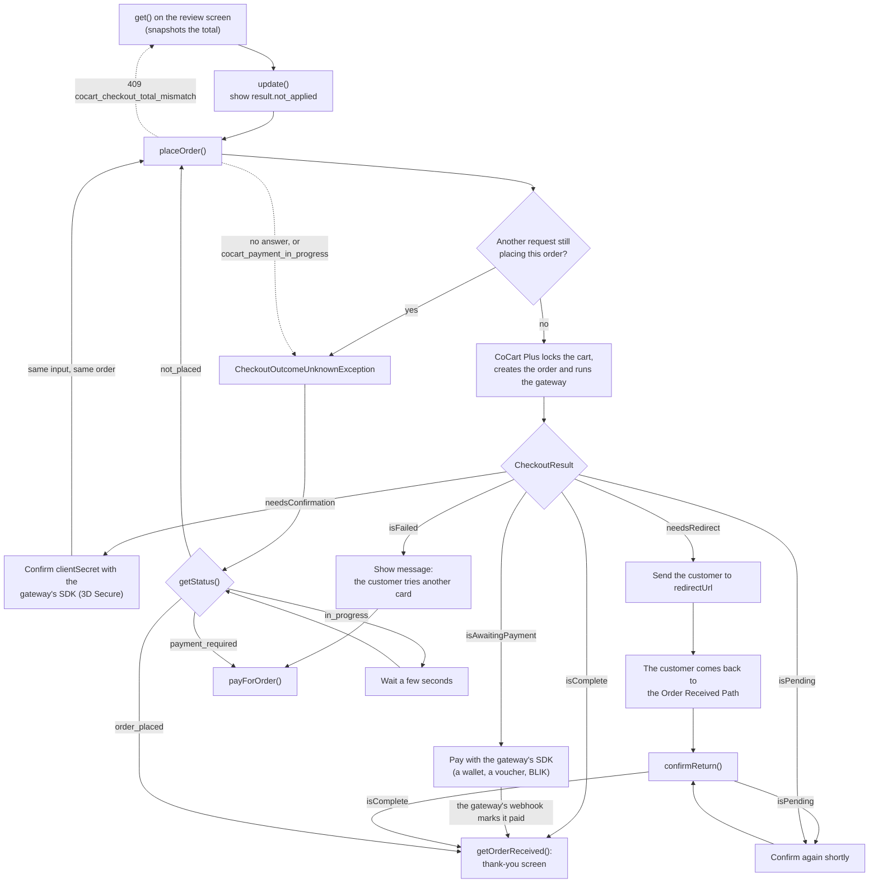

# Checkout

> Requires **CoCart Plus 2.0** and at least one WooCommerce payment gateway.

Checkout turns the customer's cart into an order and takes payment. **The card never passes through the CoCart SDK**:
- The gateway's own Android SDK (for Stripe, stripe-android with your publishable key) collects the card and sends it straight to the gateway.
- Your app gets back a payment method ID, and places the order with it.

- [How It Works](#how-it-works)
- [Quick Start](#quick-start)
- [Showing the Checkout](#showing-the-checkout)
- [Placing the Order](#placing-the-order)
- [Reading the Result](#reading-the-result)
- [3D Secure in the App](#3d-secure-in-the-app)
- [Paying Outside the Checkout](#paying-outside-the-checkout)
- [Off-Site Steps](#off-site-steps)
- [Saved Payment Methods](#saved-payment-methods)
- [The Thank-You Screen](#the-thank-you-screen)
- [Paying for an Unpaid Order](#paying-for-an-unpaid-order)
- [Address Autocomplete](#address-autocomplete)
- [Errors Before Payment](#errors-before-payment)
- [When the Outcome Isn't Known](#when-the-outcome-isnt-known)
- [Changing a Subscription's Payment Method](#changing-a-subscriptions-payment-method)

## How It Works

1. **Show the review screen** with `get()`: it snapshots the total the customer sees. Call it for that screen, not just before placing the order.
2. **Save what the customer enters** with `update()`, and show anything it couldn't apply (`result.not_applied`).
3. **The gateway's SDK turns the card into a payment method ID.**
4. **`placeOrder()`** creates the order and takes payment.
5. **Act on the result:**

   | Result | What to do |
   |---|---|
   | `isComplete` | Show the thank-you screen with `getOrderReceived()` |
   | `isAwaitingPayment` | The order is placed; the customer pays with the gateway's SDK (a wallet, a voucher, BLIK…) |
   | `needsConfirmation` | Confirm `clientSecret` with the gateway's SDK (3D Secure), then make the same call again |
   | `needsRedirect` | Open `redirectUrl` in a Custom Tab, then call `confirmReturn()` when the app reopens |
   | `isPending` | The gateway hasn't confirmed yet: confirm again shortly |
   | `isFailed` | Show `message`, then pay again with `payForOrder()` |

6. **When the answer is lost**, or another request is still taking payment (`cocart_payment_in_progress`), ask `getStatus()`: `payment_required` → `payForOrder()`; `in_progress` → ask again; `not_placed` → place the order again.
7. **`409 cocart_checkout_total_mismatch`**: the total changed since the review screen. Get the checkout again and show the new total.

The whole flow, including the lock CoCart Plus takes so that a double tap, or a request sent again, can't take payment twice:



The client never sends a checkout request again by itself, since it may already have run on the store. When no answer comes back, `placeOrder()` throws `CheckoutOutcomeUnknownException`: see [When the Outcome Isn't Known](#when-the-outcome-isnt-known).

All checkout calls are `suspend` functions and use the same client, and so the same cart, as `client.cart()`.

## Quick Start

Collect the card with Stripe's `CardInputWidget` (or `CardFormView`) and create a payment method:

```kotlin
val stripe = Stripe(context, "pk_test_…")

val params = cardInputWidget.paymentMethodCreateParams ?: return // the card isn't complete
val paymentMethod = stripe.createPaymentMethod(params)
```

Place the order:

```kotlin
val result = client.checkout().placeOrder(mapOf(
    "billing_address" to mapOf(
        "first_name" to "Jane",
        "last_name" to "Doe",
        "address_1" to "1 Main Street",
        "city" to "Paris",
        "postcode" to "75001",
        "country" to "FR",
        "email" to "jane@example.com",
    ),
    "shipping_method" to "flat_rate:1",
    "payment_method" to "stripe",
    "payment_data" to mapOf("wc-stripe-payment-method" to paymentMethod.id),
))

if (result.isComplete) {
    showThankYou(result.orderId!!, result.orderKey!!)
}
```

## Showing the Checkout

Call `get()` for the screen the customer reviews before paying. CoCart Plus remembers the total it showed, and refuses the order if the total has changed by then (`409 cocart_checkout_total_mismatch`), so the customer never pays an amount they didn't see. Don't call it just before placing the order: that would snapshot a total the customer hasn't seen.

```kotlin
val checkout = client.checkout().get()

checkout.get("totals.total")             // in minor units, e.g. "2300"
checkout.get("total_lines")              // display-ready lines
checkout.get("payment.needs_payment")    // false when the order is free
checkout.get("delivery.needs_shipping")
checkout.get("delivery.packages")        // each package with its rates and chosen_rate
```

`get()` takes optional parameters: `currency`, `formatted` (prices as formatted strings) and `thumb` (item thumbnails):

```kotlin
client.checkout().get(mapOf("currency" to "EUR", "formatted" to true, "thumb" to false))
```

Save what the customer has entered so far, without placing the order. The totals, taxes and shipping rates update to match. `update()` also applies or removes a coupon (`coupon_code` with `coupon_action` `apply` or `remove`):

```kotlin
val updated = client.checkout().update(mapOf(
    "billing_address" to mapOf("country" to "FR", "postcode" to "75001"),
    "shipping_method" to "flat_rate:1",
))

updated.get("result.code")        // "checkout_updated", or "checkout_partly_updated"
updated.get("result.not_applied") // what wasn't applied: [{field, code, message}]
```

Show each `not_applied` entry's `message` next to its `field`. The returned checkout carries the new total, so show it too.

The store's form settings: fields, required fields per country, countries, and whether guests can check out. Build your form from these. No cart needed:

```kotlin
val config = client.checkout().getConfig()
config.get("fields.billing")
config.get("countries")
config.get("order_received_url")            // where customers come back after an off-site step
config.get("address_autocomplete.enabled")  // whether searchAddresses() works
config.get("store.terms_text")              // with store.terms_links, terms_url and privacy_url
```

The payment methods for this cart:

```kotlin
val methods = client.checkout().getPaymentMethods().get("payment_methods") as List<*>
methods.forEach { method -> /* id, title, description, supports, saved_tokens */ }
```

Shipping methods work as in the [cart](cart.md).

## Placing the Order

| Field | Notes |
|---|---|
| `billing_address` | `first_name`, `last_name`, `address_1`, `city`, `postcode`, `country` and `email` at least, plus what `getConfig()` marks required |
| `shipping_address` | Same fields, when shipping goes elsewhere |
| `shipping_method` | A rate ID from `delivery.packages` |
| `payment_method` | A gateway ID: `stripe`, `woocommerce_payments`, `paypal`, `bacs`, `cod`…; leave it out for a free order |
| `payment_data` | The gateway's tokens, as a map (below) |
| `customer_note` | Optional |
| `create_account`, `customer_password` | Create an account for a guest, when the store allows it |
| `checkout_id` | Optional: 16 to 64 letters, digits, `-` or `_`. Left out, the SDK sends a random one |

`payment_data` carries the gateway's tokens only: the keys the WooCommerce gateway reads. The addresses, shipping method and note go in their own fields, never in `payment_data`.

| To… | Key | Value |
|---|---|---|
| Charge a new Stripe card | `wc-stripe-payment-method` | The payment method ID (`pm_…`) |
| Charge a new WooPayments card | `wcpay-payment-method` | The payment method ID |
| Charge a saved payment method | `wc-{gateway}-payment-token` | The saved method's `id` |
| Save the new card for later | `wc-{gateway}-new-payment-method` | `true` |

Offline gateways (`bacs`, `cheque`, `cod`) need no `payment_data`. A free order (`payment.needs_payment` is `false`) needs neither `payment_method` nor `payment_data`. Calling `placeOrder()` again for the same cart updates the same order rather than creating a second one.

A `checkout_id` that doesn't match the rule above is refused before anything is sent: a `ValidationException` with `errorCode()` `checkout_invalid_checkout_id`.

## Reading the Result

`placeOrder()`, `payForOrder()`, `confirmReturn()` and `account().updateSubscriptionPaymentMethod()` return the order (or the subscription) with what the payment did in `result`, read into a `CheckoutResult`:

```kotlin
when {
    result.isComplete -> showThankYou(result.orderId!!, result.orderKey!!)
    result.isAwaitingPayment -> payOutsideCheckout(result) // a wallet, a voucher, BLIK…
    result.needsConfirmation -> confirmCard(result)        // 3D Secure in the app
    result.needsRedirect -> openOffSite(result.redirectUrl!!)
    result.isPending -> confirmAgainShortly(result)
    else -> showError(result.message)                      // "Your card was declined."
}
```

`CheckoutResult`:

| Property | Meaning |
|---|---|
| `code` | `result.code`, as sent: `order_placed`, `action_required`, `payment_pending`, `payment_failed`, or `payment_method_changed` for a subscription. A value a store or gateway adds comes through as it is |
| `isComplete` | `order_placed` or `payment_method_changed`, with no action: paid, nothing to pay, or held for review or offline payment |
| `isAwaitingPayment` | `order_placed` with an action: the order is placed, and the customer still pays ([Paying Outside the Checkout](#paying-outside-the-checkout)) |
| `needsConfirmation` | `action_required` with a `clientSecret`: confirm it in the app, then make the same call again |
| `needsRedirect` | `action_required` with an off-site address: open `redirectUrl`, then call `confirmReturn()` |
| `isPending` | `payment_pending`: the gateway hasn't confirmed the payment yet; confirm again shortly |
| `isFailed` | `payment_failed`: show `message`; the order can be paid again |
| `objectType` | The document returned (`object`): `order`, or `subscription`. Named `objectType` because `object` is a Kotlin keyword |
| `orderId`, `orderKey`, `orderNumber`, `orderStatus` | The order (`id`, `key`, `number`, `status.code`), when the document is an order |
| `subscriptionId` | The subscription's `id`, when the document is a subscription |
| `redirectUrl` | The off-site step when `needsRedirect`, otherwise the page to show once the payment is done. Only ever an `https` or `http` address: anything else in the response (a `javascript:` URL, another app's link) is left out |
| `clientSecret`, `intentType` | For [3D Secure in the app](#3d-secure-in-the-app), or a payment made in the app |
| `paymentMethodType` | The Stripe payment method for `isAwaitingPayment`: `cashapp`, `wechat_pay`, `boleto`, `oxxo` or `multibanco` |
| `message` | A message for the customer, for every code: why the payment failed, or that the order was received. Plain text |
| `errorCode` | CoCart's code to branch on when `isFailed` (below) |
| `gatewayErrorCode`, `gatewayMessage` | The gateway's own code and message, for your logs. Plain text |
| `actionType`, `actionData` | What the customer must do, as the gateway integration names it (`stripe_confirm_payment`, `stripe_voucher_payment`, `stripe_blik_confirmation_pending`…), and what it needs |
| `response` | The raw `CoCartResponse`: the order, or the subscription |

A declined card is `isFailed`, not an exception: exceptions are kept for requests the store refuses before it tries to take payment. A held order (`on-hold`, for review or an offline payment) is `isComplete`.

Printing a result (`toString()`) leaves out `clientSecret`, `orderKey`, `redirectUrl`, `actionData` and the response, so a log line can't leak them.

| `errorCode` | Meaning |
|---|---|
| `card_declined` | Declined, including for fraud |
| `insufficient_funds` | Not enough funds |
| `expired_card` | The card has expired |
| `incorrect_cvc`, `incorrect_number`, `incorrect_postcode` | Wrong details |
| `authentication_failed` | 3D Secure failed or was cancelled |
| `processing_error` | The gateway had a problem; try again |
| `payment_method_not_supported`, `amount_not_supported` | The gateway can't take this payment |
| `payment_failed` | The gateway didn't say why |

`message` and `gatewayMessage` are plain text: show them as text, not as HTML.

## 3D Secure in the App

Confirm `clientSecret` with Stripe's `PaymentLauncher`, then call `placeOrder()` again with the same input. It completes the same order.

```kotlin
val paymentLauncher = PaymentLauncher.create(activity, publishableKey) { paymentResult ->
    if (paymentResult is PaymentResult.Completed) {
        lifecycleScope.launch {
            val retried = client.checkout().placeOrder(order) // same input as before
            // read `retried` as above
        }
    }
}

if (result.intentType == "setup_intent") {
    paymentLauncher.handleNextActionForSetupIntent(result.clientSecret!!)
} else {
    paymentLauncher.handleNextActionForPaymentIntent(result.clientSecret!!)
}
```

## Paying Outside the Checkout

With some payment methods the order is placed before the customer pays, so `isAwaitingPayment` is `true` rather than `isComplete`. The cart has already been emptied.

- **With `clientSecret`** (Stripe's Cash App Pay, WeChat Pay, and Boleto, OXXO or Multibanco vouchers): hand it to Stripe's `PaymentLauncher` the same way as [3D Secure in the App](#3d-secure-in-the-app). It opens Cash App, shows WeChat Pay, or shows the voucher. `paymentMethodType` says which it is.
- **Without one**, `actionType` says what to show: `stripe_blik_confirmation_pending` (approve the payment in the banking app), bank transfer instructions, a Pix code or a ticket. `actionData` has what it needs.

The gateway's webhook marks the order paid, so don't call `placeOrder()` again. `checkout().getStatus()` says `payment_required` until the payment goes through, then `order_placed`. A voucher is paid later, at a bank or a shop. If the customer gives up, the order stays unpaid, and `payForOrder()` takes another payment for it.

## Off-Site Steps

Some payments finish on another site: PayPal approval, or a Stripe-hosted 3D Secure page. Open it in a Custom Tab:

```kotlin
CustomTabsIntent.Builder().build().launchUrl(context, Uri.parse(result.redirectUrl))
```

The customer comes back to the thank-you page: the **Order Received Path** set in CoCart Plus under Settings → Checkout (`/checkout/order-received/{order_id}/` by default), on your **Front-end site URL**. To have that open your app, add an [App Link](https://developer.android.com/training/app-links) for the same path. It must match the setting, so if the setting changes, the app has to change too.

```xml
<intent-filter android:autoVerify="true">
    <action android:name="android.intent.action.VIEW" />
    <category android:name="android.intent.category.DEFAULT" />
    <category android:name="android.intent.category.BROWSABLE" />
    <!-- Your Front-end site URL, and the Order Received Path set in CoCart Plus without {order_id} -->
    <data android:scheme="https" android:host="your-store.com" android:pathPrefix="/checkout/order-received/" />
</intent-filter>
```

Then hand the URL to `confirmReturn()`:

```kotlin
override fun onNewIntent(intent: Intent) {
    super.onNewIntent(intent)
    val url = intent.data?.toString() ?: return
    lifecycleScope.launch {
        val result = client.checkout().confirmReturn(url)
        when {
            result.isComplete -> showThankYou(result.orderId!!, result.orderKey!!)
            result.isPending -> showProcessing() // call confirmReturn(url) again shortly
            else -> showError(result.message)    // offer payForOrder()
        }
    }
}
```

`confirmReturn()` is safe to call more than once. It sends the order key in the request body, with every query parameter the URL carried. If your link carries the order elsewhere: `confirmReturn(url, orderId = 123, orderKey = "wc_order_…")`. `confirmOrderPayment(orderId, orderKey, returnParams)` is the same call with the parameters given yourself.

`getConfig()` gives the URL customers come back to as `order_received_url`, e.g. `https://shop.example.com/order/{order_id}?key={order_key}&order_id={order_id}`, so you know which route (or, in an app, which link) to handle.

A subscription's payment method change can send the customer off-site too (a bank, for example). They come back the same way, and the same return call finishes the change: `objectType` is `subscription`, `subscriptionId` is set, and `isComplete` (`payment_method_changed`) once the new payment method is set.

## Saved Payment Methods

A logged-in customer's saved payment methods (empty for a guest):

```kotlin
val saved = client.checkout().getSavedPaymentMethods()          // every gateway
val stripeSaved = client.checkout().getSavedPaymentMethods("stripe")

saved.forEach { method ->
    method.id                    // 7
    method.gatewayId             // "stripe"
    method.label                 // "Visa ending in 4242"
    method.type                  // "CC"
    method.expires               // "12/2030", or null when it has no expiry
    method.isDefault
    method.supportsSubscriptions // the gateway can charge renewals
}
```

Pay with one with `"payment_data" to mapOf("wc-stripe-payment-token" to method.id)`. To save a new card, add `"wc-stripe-new-payment-method" to true`.

## The Thank-You Screen

```kotlin
val order = client.checkout().getOrderReceived(orderId, orderKey)

order.get("number")
order.get("status.label")          // "Processing"
order.get("items")
order.get("totals.total")
order.get("payment.needs_payment") // true if the customer still has to pay
```

It takes optional `formatted` and `meta_keys` (a list is comma-joined): `getOrderReceived(orderId, orderKey, mapOf("formatted" to true))`. A wrong key, or someone else's order, is `404 cocart_order_not_found`.

## Paying for an Unpaid Order

```kotlin
val result = client.checkout().payForOrder(orderId, orderKey, mapOf(
    "payment_method" to "stripe",
    "payment_data" to mapOf("wc-stripe-payment-method" to paymentMethod.id),
))
```

The order key is sent in the request body, not the URL. It returns the same `CheckoutResult` as `placeOrder()`, and you read it the same way:

- a declined card is `result.isFailed`, not an exception;
- a card that needs 3D Secure gives `result.needsConfirmation`: confirm it as in [3D Secure in the App](#3d-secure-in-the-app), then call `payForOrder()` again;
- an off-site step gives `result.needsRedirect`.

An order that needs no payment or can't be paid is a `409` `CoCartException`, and so is another payment still running for it (`cocart_payment_in_progress`).

## Address Autocomplete

```kotlin
val found = client.checkout().searchAddresses("10 Downing", country = "GB")

val details = client.checkout().getAddressDetails(suggestionId, provider = found.get("provider.id") as String)
details.get("address") // address_1, city, postcode, country
```

The search needs at least 3 characters, and neither call needs a cart. Without an address provider on the store it's `404 cocart_address_search_no_provider`: check `getConfig()`'s `address_autocomplete.enabled` (and its `providers`) first.

## Errors Before Payment

When the store refuses the order before trying to take payment, `placeOrder()` throws a `CoCartException`. Every address field at fault is reported at once:

```kotlin
try {
    val result = client.checkout().placeOrder(order)
} catch (e: CoCartException) {
    e.errorCode() // e.g. "cocart_invalid_address_fields"
    e.getFields() // {"billing.postcode" to "Enter a valid postcode.", …}: show each next to its field
    e.getField()  // the first field at fault, or null
    e.message
}
```

| Code | Meaning |
|---|---|
| `cocart_cant_checkout_empty_cart` | The cart is empty |
| `cocart_address_field_required`, `cocart_invalid_address_fields` | A required address field is missing or wrong |
| `cocart_invalid_email_address`, `cocart_invalid_phone_number` | Invalid email or phone |
| `cocart_invalid_billing_postcode`, `cocart_invalid_billing_country_code` | Invalid billing postcode or country |
| `cocart_invalid_shipping_postcode`, `cocart_invalid_shipping_country_code` | Invalid shipping postcode or country |
| `cocart_no_shipping_method`, `cocart_invalid_shipping_method` | No shipping method, or one that doesn't apply |
| `cocart_invalid_payment_method`, `cocart_payment_method_not_available`, `cocart_payment_method_disabled` | The payment method can't be used |
| `cocart_payment_method_no_subscription_support` | The cart has a subscription and the gateway can't renew it |
| `cocart_product_out_of_stock`, `cocart_insufficient_stock`, `cocart_product_not_purchasable`, `cocart_product_not_exists` | A product can't be bought any more |
| `cocart_invalid_coupon`, `cocart_coupon_usage_limit`, `cocart_coupon_email_restricted` | A coupon no longer applies |
| `cocart_account_exists`, `cocart_account_creation_failed` | `create_account` failed |
| `cocart_checkout_total_mismatch` | `409`: the total changed since the review screen. Get the checkout again and show the new total |
| `checkout_invalid_checkout_id` | The `checkout_id` you passed is malformed (nothing was sent) |

`cocart_payment_in_progress` from `placeOrder()` isn't thrown as a plain error: see below.

## When the Outcome Isn't Known

If the connection drops, the request times out or a proxy gives up waiting, the order may or may not have been placed. The same goes for `409 cocart_payment_in_progress`: another request (a double tap, or a request sent again after a timeout) is still taking payment for the cart. Each order is sent with a random `checkout_id`, so `placeOrder()` throws `CheckoutOutcomeUnknownException` with that ID, and `getStatus()` asks CoCart Plus 2.0 how the checkout ended. Ask from the same cart, or as the same customer.

```kotlin
try {
    val result = client.checkout().placeOrder(input)
} catch (e: CheckoutOutcomeUnknownException) {
    val status = client.checkout().getStatus(e.checkoutId)
    when (status.code) {
        "order_placed" -> { /* It went through: show status.orderId with status.orderKey. */ }
        "payment_required" -> { /* Placed but not paid: payForOrder(status.orderId!!, status.orderKey!!, …). */ }
        "in_progress" -> { /* Still running: ask again in a few seconds. */ }
        else -> { /* not_placed: nothing went through, placeOrder(input) again. */ }
    }
}
```

`CheckoutStatus` has `checkoutId`, `code`, `message` (for the customer, plain text), and `orderId`, `orderKey`, `orderNumber` and `orderStatus` (the order's `status.code`), which are `null` unless an order was placed or needs payment.

`CheckoutOutcomeUnknownException` is a `CoCartException` with the original error's message, status code and data, and the original error (`NetworkException`, the proxy's 502 or 504, or the `409`) as its cause. Put your own `checkout_id` in the input if you'd rather keep it yourself.

If the gateway's webhook paid the order after a 3D Secure confirmation in the page, placing the order again reports that order as complete rather than placing another.

## Changing a Subscription's Payment Method

See [Account](account.md#changing-a-subscriptions-payment-method).
